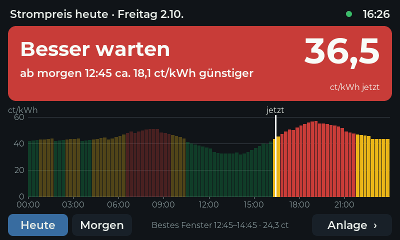
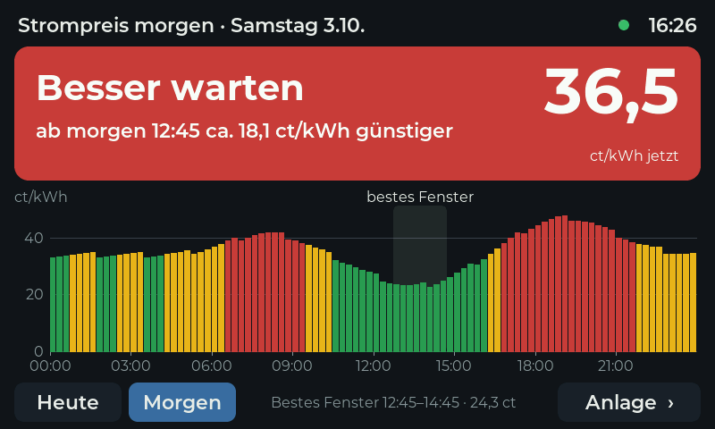
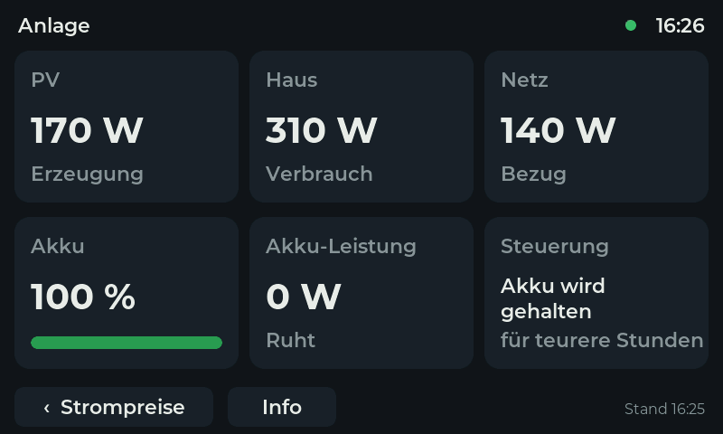
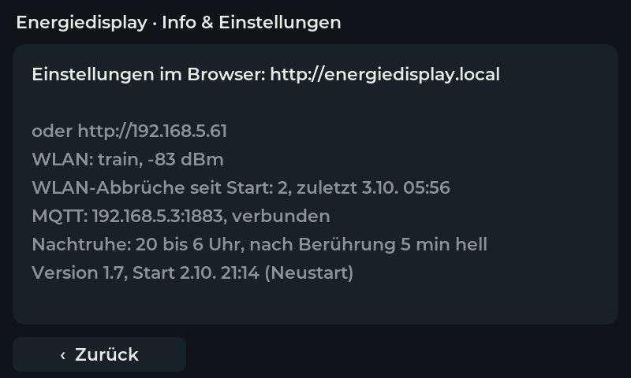
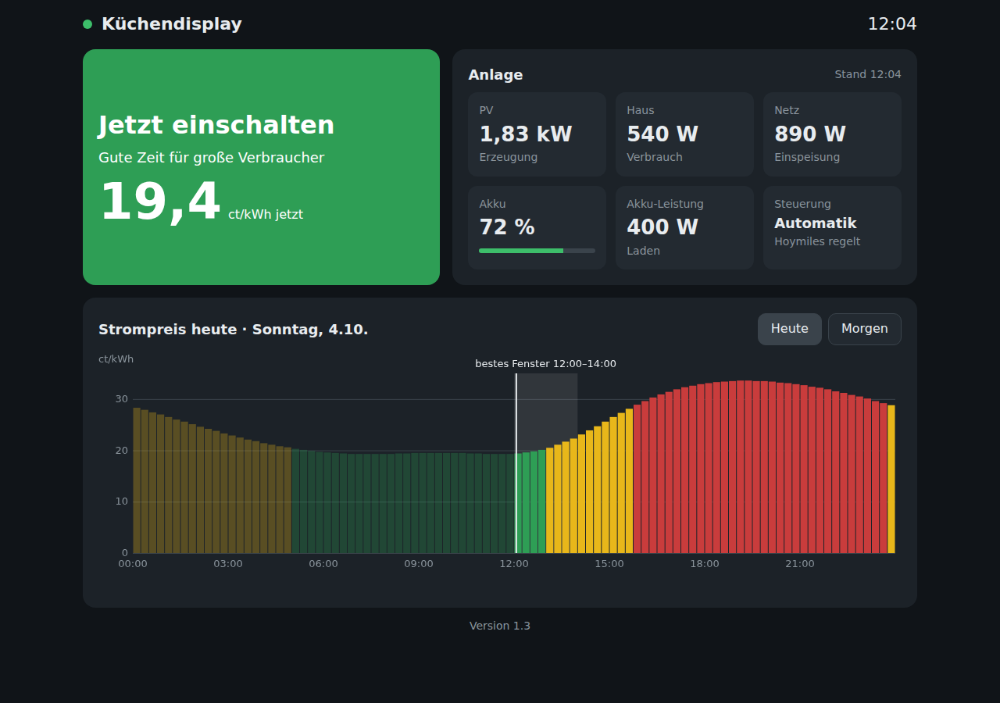
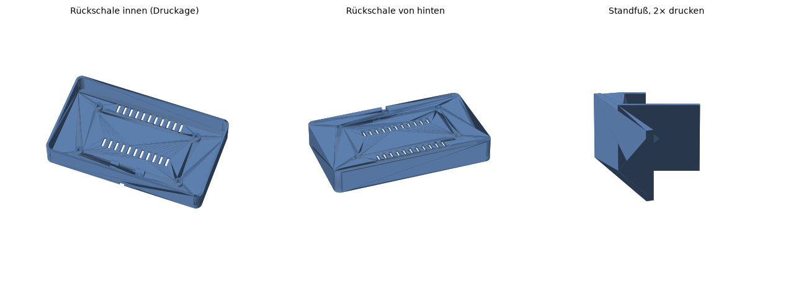

# Energiedisplay

7"-Touch-Display für die Küche, das den aktuellen Strompreis (dynamischer Tarif, EPEX-Viertelstundenpreise), die PV-Leistung und den Akkustand zeigt. Dazu gehören ein Python-Controller, der einen Hoymiles-Akku (HiBattery) nach Strompreis und PV-Prognose steuert, und ein 3D-druckbares Gehäuse.

| Strompreis heute | Strompreis morgen | Anlage | Info |
|---|---|---|---|
|  |  |  |  |

## Aufbau

```
Strompreis-API (Energy-Charts, Ersatz aWATTar)
        │
        ▼
qnap/controller.py ──── MQTT ────► Hoymiles-Speicher (Laden / Halten / Entladen)
        │ schreibt epex_prices.json
        ▼
qnap/kuechendisplay.py ── MQTT (kueche/*) ──► Energiedisplay (ESP32-S3)
        └── Webseite für den PC (Port 8088)
```

Beide Python-Programme laufen bei mir als Container auf einem QNAP-NAS, jedes andere System mit Python 3.11 und einem MQTT-Broker (z. B. Mosquitto) geht genauso.

## Inhalt

| Ordner | Inhalt |
|---|---|
| `firmware/energiedisplay/` | Firmware für das Display (PlatformIO, Arduino, LVGL 8.3) |
| `firmware/testbild/` | Minimales Testbild zur Inbetriebnahme des Displays |
| `qnap/controller.py` | Akku-Steuerung nach Strompreis und PV-Prognose |
| `qnap/kuechendisplay.py` | Bereitet Preise und Anlagenwerte für das Display auf, mit Webseite |
| `gehaeuse/` | Rückschale und Standfuß als STL, Generator-Skript `gehaeuse.py` |
| `docs/bilder/` | Vorschaubilder |

## Hardware

- Waveshare ESP32-S3-Touch-LCD-7 (Rev 1.2, ESP32-S3-WROOM-1 N16R8: 16 MB Flash, 8 MB PSRAM, GT911-Touch, CH422G-IO-Expander)
- Hoymiles-Speicher mit MQTT (bei mir 2 Geräte in Kaskade)
- MQTT-Broker im Heimnetz

## Firmware

1. `firmware/energiedisplay/src/config.example.h` nach `config.h` kopieren und WLAN, MQTT-Broker und Passwörter eintragen. `config.h` steht in `.gitignore`.
2. Den Ordner `firmware/energiedisplay` in VS Code mit PlatformIO öffnen.
3. Erstes Aufspielen per USB über die Buchse **UART1** (Schiebeschalter auf UART1), Umgebung `energiedisplay`.
4. Danach geht es übers WLAN mit der Umgebung `energiedisplay-wlan`. Dafür das `OTA_PASSWORT` aus `config.h` in `platformio.ini` bei `--auth` eintragen.

Die Werte aus `config.h` gelten nur beim allerersten Start. Danach werden WLAN, MQTT und Nachtruhe auf der Einstellungsseite `http://energiedisplay.local` geändert und im Gerät gespeichert. Ist das WLAN 60 Sekunden lang nicht erreichbar, öffnet das Display den Hotspot `Energiedisplay-Setup` mit der Einstellungsseite unter `http://192.168.4.1`.

Klappt der Upload nicht („No serial data received“): Schiebeschalter prüfen, dann BOOT halten und RESET drücken.

Die Schriften unter `src/fonts/` sind mit `lv_font_conv` aus Montserrat (SIL Open Font License) erzeugt und enthalten die deutschen Umlaute.

## QNAP / Python

Benötigt Python 3.11 und `paho-mqtt` (`pip install paho-mqtt`).

**controller.py** liest seine Einstellungen aus `/app/config.json`. Vorlage: `qnap/config.example.json`. Fehlt ein Wert, gilt der Standardwert im Code. Im Container-Command `exec python /app/controller.py` verwenden, damit der Controller bei `docker stop` sauber beendet und den Speicher zurück auf „general“ stellt.

**kuechendisplay.py** wird über Umgebungsvariablen eingestellt:

| Variable | Standard | Bedeutung |
|---|---|---|
| `MQTT_BROKER` | `192.168.1.10` | IP des Brokers |
| `MQTT_PORT` | `1883` | Port des Brokers |
| `MQTT_USER`, `MQTT_PASS` | leer | Anmeldung am Broker |
| `HOYMILES_MASTER` | `MSA-000000000000` | Geräte-ID des Master-Speichers |
| `WEB_PORT` | `8088` | Webseite für den PC, `0` = aus |
| `PRICE_FILE` | `/app/epex_prices.json` | Preisdatei, die der Controller schreibt |

Test ohne MQTT: `python kuechendisplay.py --test`



Die MQTT-Topics heißen aus Kompatibilitätsgründen weiter `kueche/preise`, `kueche/ampel`, `kueche/anlage` und `kueche/status`.

## Gehäuse

`gehaeuse/rueckschale.stl` (1×) und `gehaeuse/standfuss.stl` (2×) drucken. Die Rückschale wird mit M3-Schrauben auf die mitgelieferten 8-mm-Abstandsbolzen des Displays geschraubt, das Display steht mit 20° Neigung auf dem Tisch.

Andere Maße: Werte oben in `gehaeuse.py` anpassen und neu erzeugen:

```
pip install manifold3d trimesh numpy
python gehaeuse/gehaeuse.py gehaeuse
```


